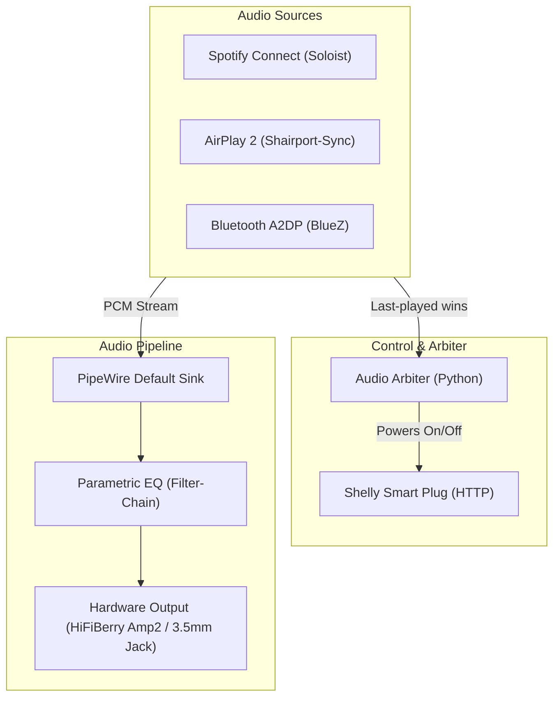

# 🎵 nix-pi-audio

<p align="center">
  <strong>Turn your Raspberry Pi 4 into a rock-solid, multi-source audiophile streamer with NixOS.</strong>
</p>

<p align="center">
  
  
  
  
  
</p>

> [!NOTE]
> This project was designed and developed with the assistance of artificial intelligence agents (**Claude Code** and **Antigravity**).  
> The [`spec/`](spec/) directory contains the formal architectural specifications that serve as the project's single source of truth.

---

## ✨ Highlights

- **🎧 Three Seamless Audio Sources:**
  - **Spotify Connect** powered by official [Spotify Soloist](https://developer.spotify.com/documentation/soloist) (auto-updating headless daemon).
  - **AirPlay 2** with CD-quality / PTP clock synchronization (`shairport-sync` + `nqptp`).
  - **Bluetooth A2DP** receiver with high-quality SBC-XQ and auto-reconnect.
- **🔀 Smart Audio Arbiter:** The last source to play wins. The arbiter automatically pauses or disconnects the previous source to prevent audio collision.
- **🎚️ Parametric Equalizer (DSP):** Integrated PipeWire filter-chain PEQ (including Moode Audio curve migrations) to tune sound to your room and speakers.
- **🔌 Smart Home Integration:** Automatically powers your speakers on/off via a [Shelly](https://www.shelly.com/) smart plug based on playback state.
- **💡 Visual Health Indicator:** Onboard ACT and PWR LEDs stay lit during boot and automatically shut off once all audio services are verified healthy.
- **🛡️ SD Card Longevity:** Built with minimal SD card wear in mind—logs, `/tmp`, and the Spotify playback cache live entirely in RAM (tmpfs).
- **⚙️ Zero-Touch Configuration:** Set your Wi-Fi, Spotify API key, and Tailscale credentials in a simple `soloist.env` file on the FAT partition from any PC or Mac.
- **🔒 Remote Administration:** Secure access via Tailscale SSH with zero open ports exposed to the internet.

---

## 📐 Architecture Overview



---

## 🚀 Quickstart Guide

### 1. Download or Build the SD Card Image

Pre-built images are published as GitHub Actions artifacts (`image` workflow). Alternatively, build an image locally:

```bash
# Build image for Chambre de Léo (HiFiBerry Amp2)
nix build .#chambre-de-leo-image

# Or build for Chambre de Sarah (3.5 mm onboard jack)
nix build .#chambre-de-sarah-image
```

The resulting image will be located at `result/sd-image/*.img.zst`.

### 2. Flash the SD Card

Flash the compressed image using [Raspberry Pi Imager](https://www.raspberrypi.com/software/), [balenaEtcher](https://etcher.balena.io/), or the command line:

```bash
zstd -dc result/sd-image/*.img.zst | sudo dd of=/dev/sdX bs=4M conv=fsync status=progress
```

*(Replace `/dev/sdX` with your SD card device identifier).*

### 3. Configure Network & Credentials

Re-insert the flashed SD card into your computer. The FAT32 partition (`FIRMWARE`) will mount automatically.

Copy `soloist.env.example` to `soloist.env` and fill in your settings:

```ini
# Wi-Fi Configuration
WIFI_SSID=MyHomeNetwork
WIFI_PASSWORD=SecretPassword
WIFI_COUNTRY=FR

# Spotify Soloist API Key (obtain from https://developer.spotify.com/dashboard/soloist)
SOLOIST_API_KEY=spak_...

# Tailscale Remote Access (optional but recommended)
TAILSCALE_AUTHKEY=tskey-auth-...

# Smart Plug, Onkyo Receiver & Notifications (optional)
SHELLY_HOST=192.168.1.50
ONKYO_HOST=                 # Leave empty for UDP auto-discovery, IP for fixed, or "false" to disable
DISCORD_WEBHOOK=https://discord.com/api/webhooks/...
```

> [!TIP]
> Leaving `WIFI_SSID` empty configures Ethernet-only networking. The `soloist.env` file is read on every boot, so you can change your Wi-Fi network at any time simply by editing the file on the card.

### 4. Boot & Enjoy

1. Insert the SD card into your Raspberry Pi 4 and power it on.
2. **Watch the LEDs:** The PWR (red) and ACT (green) LEDs will stay on during boot. As soon as all audio daemons are healthy and ready, **both LEDs turn off automatically**.
3. Open Spotify on your phone or computer and select your new speaker in the device picker!

---

## 🎛️ Devices & Hardware Profiles

Configurations are modular and split per device under `hosts/devices/`:

| Device | Output Hardware | Features | Config File |
|---|---|---|---|
| **Chambre de Léo** | HiFiBerry Amp2 (HAT) | 10-Band Parametric EQ ("Lo Boost"), Shelly control | [`hosts/devices/chambre-de-leo.nix`](hosts/devices/chambre-de-leo.nix) |
| **Chambre de Sarah** | 3.5 mm Onboard Analog Jack | Standard stereo output | [`hosts/devices/chambre-de-sarah.nix`](hosts/devices/chambre-de-sarah.nix) |
| **Télévision** | HiFiBerry Digi (S/PDIF) | Onkyo AV Receiver Bridge (eISCP auto-discovery, power, input & volume) | [`hosts/devices/television.nix`](hosts/devices/television.nix) |

### Adding a New Device

1. Create `hosts/devices/<my-device>.nix`:
   ```nix
   {
     hostName = "salon";
     deviceName = "Salon";
     audioOutput = "hifiberry-amp2"; # or "jack"
     
     # Optional: Custom Parametric EQ
     equalizer = {
       enable = true;
       preamp = -4.8;
       bands = [
         { freq = 31.0; q = 1.41; gain = 6.0; }
       ];
     };
   }
   ```
2. Add `"salon"` to `soloistDevices` in [`flake.nix`](flake.nix).

---

## 🛠️ Management & Maintenance

### Remote Updates (`pi-update`)

Connect to the Pi via Tailscale SSH and run:

```bash
# Update to latest production build (from Cachix cache)
pi-update

# Or test a development branch directly
pi-update main
```

If the kernel or bootloader changed, `pi-update` will notify you that a reboot is recommended.

### Useful Status Commands

```bash
# Check status of audio daemons
systemctl status soloist shairport-sync bluetooth audio-arbiter

# Check PipeWire audio routing and active volume levels
wpctl status

# Inspect audio arbiter logs in real time
journalctl -u audio-arbiter -f
```

---

## 📂 Repository Structure

```text
├── flake.nix                # System entry point & device matrix
├── hosts/
│   ├── default.nix          # Base NixOS config (PipeWire, health LEDs, system tuning)
│   ├── settings.nix         # Shared default parameters
│   ├── equalizer.nix        # Parametric EQ PipeWire filter-chain module
│   ├── soloist.nix          # Spotify Soloist daemon & auto-updater
│   ├── airplay.nix          # AirPlay 2 daemon (shairport-sync) & PTP clock (nqptp)
│   ├── bluetooth.nix        # BlueZ A2DP Bluetooth receiver
│   ├── arbiter.nix          # Audio source arbiter & Shelly plug integration
│   ├── arbiter.py           # Arbiter logic (D-Bus, WebSocket & HTTP)
│   ├── sd-config.nix        # Parses soloist.env from FAT boot partition
│   ├── autoupgrade.nix      # Automated nightly updates & Discord webhooks
│   └── devices/             # Host-specific settings (Léo, Sarah...)
└── .github/workflows/       # CI/CD pipelines (kernel builder, caching, image artifact)
```

---

## 📄 License

This project is licensed under the [MIT License](LICENSE). Spotify Soloist binary is subject to [Spotify Developer Terms](https://developer.spotify.com/terms).
