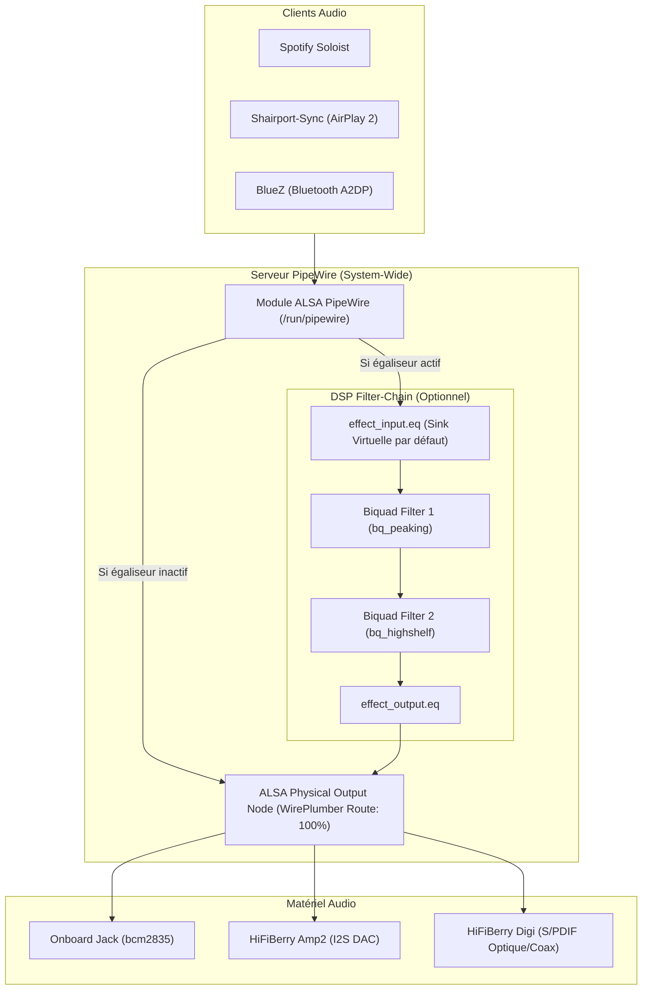

# Spécification 01 : Pile Audio Logicielle & Pipeline DSP

## 1. Vue d'ensemble du Pipeline Audio

Toutes les sources audio (Spotify Soloist, AirPlay 2 via Shairport-Sync, Bluetooth via BlueZ) acheminent leur flux audio PCM stéréo (44.1 kHz / 48 kHz, 16/24-bit) vers un serveur **PipeWire fonctionnant en mode système** (`services.pipewire.systemWide = true`).



---

## 2. Configuration PipeWire & WirePlumber

### 2.1 Mode Système (`systemWide = true`)
- PipeWire s'exécute sous l'utilisateur système `pipewire`, sans session utilisateur de bureau.
- Le répertoire de runtime est fixé à `/run/pipewire`.
- Les permissions d'accès sont accordées via le groupe système `pipewire` ou l'IPC unix socket.
- Les clients (Soloist, Shairport-Sync, BlueZ) injectent leur audio via la bibliothèque d'adaptation ALSA `libasound_module_pcm_pipewire.so`.

### 2.2 Priorités et Volume Hardware WirePlumber
- **Volume ALSA matériel forcé à 100% :**  
  Par défaut, WirePlumber initialise les cartes sons physiques à 40% de leur volume (-24 dB). Pour préserver l'intégrité de la dynamique et laisser le contrôle du volume aux applications (ou à l'amplificateur Onkyo), WirePlumber est configuré avec :
  ```nix
  wireplumber.extraConfig."50-default-volume"."wireplumber.settings" = {
    "device.routes.default-sink-volume" = 1.0;
  };
  ```
- **Optimisation embarquée (désactivation caméra) :**  
  WirePlumber scrute par défaut les périphériques vidéo/V4L2 (`libcamera`). Pour accélérer le boot et éliminer les erreurs `DmaBufAllocator`, la capture vidéo est désactivée :
  ```nix
  wireplumber.extraConfig."10-disable-camera"."wireplumber.profiles" = {
    main = { "hardware.video-capture" = "disabled"; };
  };
  ```

---

## 3. Égaliseur Paramétrique DSP (`hosts/equalizer.nix`)

### 3.1 Architecture du Filter-Chain
L'égaliseur est instancié via le module PipeWire natif `libpipewire-module-filter-chain`.
- **Nom du nœud d'entrée :** `effect_input.eq` (exposé comme Sink PipeWire pour les flux entrants).
- **Nom du nœud de sortie :** `effect_output.eq` (connecté à la Sink physique ALSA).
- **Stéréo et Clonage de Canaux :**  
  Les nœuds de filtres biquad de PipeWire (`bq_peaking`, `bq_highshelf`, `bq_lowshelf`) sont des primitives mono disposant d'un port d'entrée unique `In` et d'un port de sortie `Out`.  
  Pour traiter un signal stéréo sans créer de déséquilibre ni provoquer d'erreur `unknown output port`, le filtre déclare :
  ```text
  audio.channels = 2
  audio.position = [ "FL" "FR" ]
  ```
  PipeWire clone automatiquement le graphe de traitement mono sur les canaux gauche et droit.

### 3.2 Priorité de Routage
Pour que tout nouveau flux audio s'oriente automatiquement vers l'égaliseur plutôt que directement vers la carte son brute, les priorités du nœud `effect_input.eq` sont surélevées :
```text
priority.driver = 2000
priority.session = 2000
```

### 3.3 Structure de Gain & Préamplification
Lors de l'application de corrections positives (boost), un gain numérique d'atténuation global (**Preamp**) doit être appliqué afin de préserver une marge dynamique (*headroom*) et d'éviter tout écrêtage numérique (*clipping* 0 dBFS).
Exemple appliqué pour le profil `chambre-de-leo` (migration de la courbe Moode Audio *Lo Boost*) :
- `preamp` = -4.80 dB
- Bande 1 : 31 Hz, Q = 1.41, Gain = +12.24 dB (relatif à la référence plate)
- Bande 2 : 63 Hz, Q = 1.41, Gain = +4.32 dB
