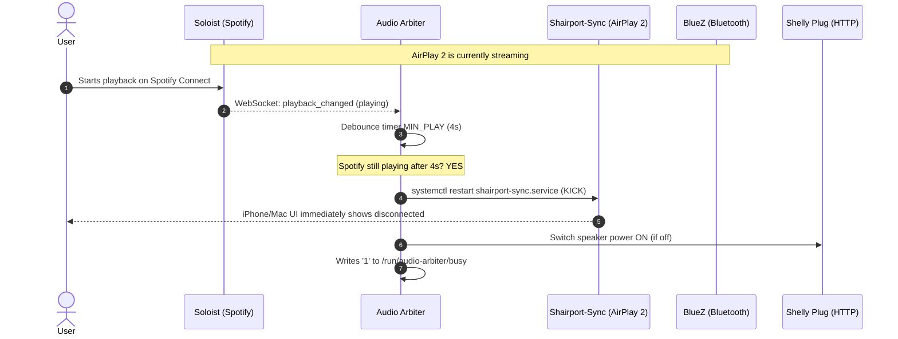

# Specification 02: Audio Sources & Arbitration

## 1. Audio Sources

The system runs three independent audio receiver daemons:

### 1.1 Spotify Connect (Soloist) — [`hosts/soloist.nix`](../hosts/soloist.nix)
- **Binary:** Official proprietary Spotify Soloist daemon for ARM64 (`aarch64-linux`), which updates itself in place.
- **Authentication:** Requires a Spotify Soloist API key (`SOLOIST_API_KEY`) supplied in `soloist.env`.
- **RAM Cache (tmpfs):** To protect the SD card from flash wear caused by continuous streaming, Soloist's playback cache is stored in a dedicated `tmpfs` mounted at `/var/cache/soloist`:
  - Size: `cacheRamPercent` (30% of total system RAM, ~1.2 GB on a 4 GB Pi 4).
  - Maximum allocation: `cacheFillPercent` (85% of that tmpfs).
- **Telemetry & WebSocket API:** Soloist provides a local unauthenticated WebSocket server at `127.0.0.1:8765`. Real-time `playback_changed` events publish current playback states (`playing`, `paused`, `buffering`, `idle`).

### 1.2 AirPlay 2 (Shairport-Sync) — [`hosts/airplay.nix`](../hosts/airplay.nix)
- **Binary:** `shairport-sync` compiled with AirPlay 2 support (PipeWire audio backend, ALAC/AAC hardware/software decryption).
- **PTP Clock Synchronization:** Coupled with `nqptp` (listening on UDP ports 319 and 320) for multi-room sub-millisecond clock synchronization.
- **mDNS Announcement:** Broadcasted across the local network via Avahi using the configured device display name (`settings.deviceName`).
- **Session State Hooks:**
  - Playback start hook: creates marker file `/run/audio-arbiter/airplay`.
  - Playback end hook: deletes marker file `/run/audio-arbiter/airplay`.

### 1.3 Bluetooth Audio (BlueZ A2DP) — [`hosts/bluetooth.nix`](../hosts/bluetooth.nix)
- **Bluetooth Stack:** BlueZ 5 running in A2DP Sink mode.
- **Audio Codecs:** High-bitrate SBC and SBC-XQ.
- **Bluetooth Agent:** Automatic background `bt-agent` accepting pairing requests without PIN codes.
- **Device Broadcast Name:** Advertised on Bluetooth as `<settings.deviceName> BT`.
- **Playback Detection:** Monitors D-Bus (`org.bluez`) for connected `org.bluez.Device1` objects (each one a source) and, per device, an active `org.bluez.MediaTransport1` (`State == "active"`) meaning it is playing.

---

## 2. Audio Arbiter Daemon (`audio-arbiter.service`)

The Python daemon [`hosts/arbiter.py`](../hosts/arbiter.py) runs continuously to enforce mutual exclusivity: **the most recently started playback source wins**.

---

## 3. Arbitration Rules & Timing Parameters

| Parameter | Default Value | Purpose |
|:---|:---|:---|
| `MIN_PLAY` | `4.0 s` | Minimum duration a source must sustain uninterrupted playback before kicking other sources. Prevents accidental disconnects from track browsing, incoming notifications, or connection handshakes. |
| `LOCKOUT` | `15.0 s` | Immunity window preventing a recently disconnected source from immediately re-interrupting the new source. |
| `OFF_DELAY` | `20.0 s` | Silence duration required before switching off the Shelly speaker plug. |
| `STATE_DIR` | `/run/audio-arbiter` | In-memory `tmpfs` directory for IPC state files. |

### 3.1 Kick (Disconnect) Mechanism
To ensure streaming applications visibly reflect the handover on phones and laptops, competing sources are disconnected rather than merely muted:
- **Spotify:** Restarts `soloist.service` via `systemctl restart`. The Spotify app immediately drops back to local playback.
- **AirPlay 2:** Removes `/run/audio-arbiter/airplay` and restarts `shairport-sync.service`. iOS/macOS Control Center releases the route.
- **Bluetooth:** see section 3.3.

### 3.3 Bluetooth: every device is a source
- The arbiter tracks **all** connected BlueZ devices (`org.bluez.Device1` with `Connected == true`). Each one is a distinct source keyed `bt:<D-Bus object path>`; it counts as *playing* only while its `org.bluez.MediaTransport1` is `active`. A device that is connected but idle never makes the system busy (`busy` stays `0`, the Shelly plug is not held on).
- When any source wins (after the usual `MIN_PLAY` confirmation), **every connected Bluetooth device other than the winner is disconnected**, playing or not (`devices_to_disconnect(winner, connected_devices)`). If the winner is a Bluetooth device it is the only one left connected: one phone at a time, the last one to play wins.
- Clean disconnect: if the device exposes an AVRCP player (`org.bluez.MediaPlayer1` under its path), `Pause` is sent first (errors ignored), the arbiter waits `BT_PAUSE_WAIT` (0.3 s), then calls `Device1.Disconnect`. Each disconnection is logged (`disconnected <device> (pause sent | no player)`). An error on one device does not prevent the others from being handled.
- No kick loop: a disconnected device gets a `LOCKOUT` (15 s) that survives its disconnection, so when it reconnects by itself (an iPhone does so after about 40 s) a short "playing" blip cannot win; it must play for `MIN_PLAY` (4 s) like any other source.

### 3.2 IPC State Contract
- `/run/audio-arbiter/busy`: Contains `1\n` if any source is actively playing (`any(playing.values())`), or `0\n` when idle. Connected but idle Bluetooth devices do not count. Read by [`hosts/onkyo-bridge.py`](../hosts/onkyo-bridge.py) for zero-latency audio detection.
- `/run/audio-arbiter/airplay`: Present only while AirPlay 2 is actively rendering audio.
