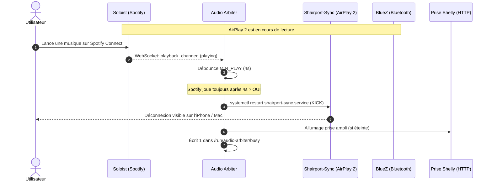

# Spécification 02 : Sources Audio & Démon d'Arbitrage

## 1. Description des Sources Audio

Le système héberge trois démons récepteurs audio indépendants :

### 1.1 Spotify Connect (Soloist) — [`hosts/soloist.nix`](../hosts/soloist.nix)
- **Binaire :** Binaire officiel propriétaire Spotify Soloist pour architecture ARM64 (`aarch64-linux`), mis à jour automatiquement par le démon lui-même.
- **Authentification :** Nécessite une clé d'API Spotify Soloist (`SOLOIST_API_KEY`) fournie via `soloist.env`.
- **Cache en RAM (tmpfs) :** Pour protéger la carte SD contre l'usure intensive des flux audio Spotify, le cache de lecture Soloist réside intégralement sur un volume `tmpfs` monté sur `/var/cache/soloist` :
  - Taille : `cacheRamPercent` (30% de la RAM totale du Pi, soit ~1.2 Go sur un Pi 4 4Go).
  - Remplissage max : `cacheFillPercent` (85% de ce tmpfs).
- **Télémétrie & API WebSocket :** Soloist expose une API WebSocket locale sur `127.0.0.1:8765`. Les événements `playback_changed` diffusent en temps réel l'état (`playing`, `paused`, `buffering`, `idle`).

### 1.2 AirPlay 2 (Shairport-Sync) — [`hosts/airplay.nix`](../hosts/airplay.nix)
- **Binaire :** `shairport-sync` compilé avec le support AirPlay 2 (backend PipeWire, chiffrement ALAC/AAC).
- **Horloge réseau PTP :** Accompagné du démon `nqptp` (ports UDP 319 et 320) pour la synchronisation précise inter-enceintes AirPlay 2.
- **Annonce mDNS :** Annoncé sur le réseau local via Avahi sous le nom d'affichage de l'hôte (`settings.deviceName`).
- **Hooks d'état de session :**
  - Début de lecture : création du fichier témoin `/run/audio-arbiter/airplay`.
  - Fin de lecture : suppression du fichier témoin `/run/audio-arbiter/airplay`.

### 1.3 Bluetooth Audio A2DP — [`hosts/bluetooth.nix`](../hosts/bluetooth.nix)
- **Pile Bluetooth :** BlueZ 5 avec profil audio récepteur (A2DP Sink).
- **Codecs :** SBC et SBC-XQ haute définition (débit élevé).
- **Agent Bluetooth :** Démon `bt-agent` automatique validant toutes les demandes d'appairage sans code PIN.
- **Nom d'affichage :** Annoncé sous la forme `<settings.deviceName> BT`.
- **Détection d'état :** Écoute sur le bus système D-Bus (`org.bluez`) des interfaces `org.bluez.MediaTransport1` avec l'état `State == "active"`.

---

## 2. Démon d'Arbitrage Audio (`audio-arbiter.service`)

Le démon Python [`hosts/arbiter.py`](../hosts/arbiter.py) tourne en permanence pour appliquer la règle fondamentale du système : **le dernier flux lancé prend le contrôle exclusif de la sortie audio**.

---

## 3. Règles et Paramètres d'Arbitrage

| Paramètre | Valeur par défaut | Rôle |
|:---|:---|:---|
| `MIN_PLAY` | `4.0 s` | Temps minimal pendant lequel une source doit jouer sans interruption avant de déconnecter les autres. Évite les faux positifs (changement de piste, sonnerie brève, appairage téléphonique). |
| `LOCKOUT` | `15.0 s` | Période d'immunité empêchant la source venant d'être déconnectée de réattaquer immédiatement. |
| `OFF_DELAY` | `20.0 s` | Délai de silence absolu avant extinction de la prise intelligente Shelly. |
| `STATE_DIR` | `/run/audio-arbiter` | Répertoire en mémoire vive (tmpfs) hébergeant les drapeaux IPC. |

### 3.1 Mécanismes d'expulsion (*Kick*)
Pour qu'un utilisateur comprenne immédiatement sur son smartphone ou son Mac qu'une autre personne a pris la main sur l'enceinte, la source concurrente est **déconnectée** et non pas simplement étouffée :
- **Spotify :** Redémarrage de `soloist.service` via `systemctl restart`. L'application Spotify affiche immédiatement la déconnexion de l'enceinte.
- **AirPlay 2 :** Suppression du flag `/run/audio-arbiter/airplay` et redémarrage de `shairport-sync.service`. Le centre de contrôle iOS libère l'enceinte.
- **Bluetooth :** Appel D-Bus `org.bluez.Device1.Disconnect` sur l'adresse MAC du périphérique émetteur actif.

### 3.2 Contrat IPC (Fichiers d'état partagés)
- `/run/audio-arbiter/busy` : Contient `1\n` si au moins une source est active (`any(playing.values())`), `0\n` en cas de silence. Ce fichier est lu par le pont Onkyo ([`hosts/onkyo-bridge.py`](../hosts/onkyo-bridge.py)) pour connaître instantanément l'état audio sans latence.
- `/run/audio-arbiter/airplay` : Fichier présent uniquement pendant qu'AirPlay 2 émet du son.
