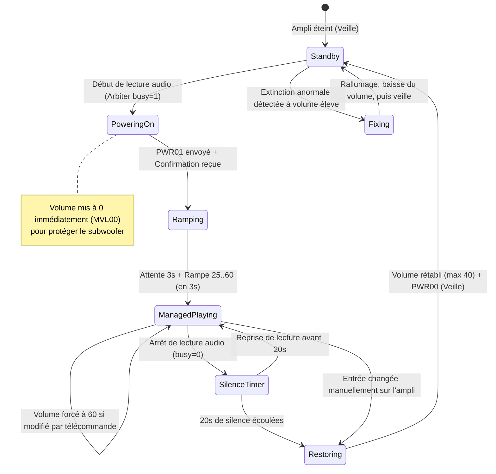

# Spécification 04 : Pont de Contrôle Amplificateur Onkyo

## 1. Protocole eISCP (Ethernet Interactive Serial Control Protocol)

Le contrôle de l'amplificateur Onkyo s'effectue via le protocole réseau propriétaire eISCP sur les ports :
- **TCP 60128 :** Canal de commande et de télémétrie bidirectionnel persistant.
- **UDP 60128 :** Canal de découverte automatique par diffusion broadcast.

### 1.1 Structure d'une Trame eISCP
Toute trame de commande ou de réponse encapsule un message dans une en-tête binaire fixe de 16 octets :

| Octets | Type | Valeur / Rôle |
|:---|:---|:---|
| 0 à 3 | 4 caractères ASCII | Identifiant magique `ISCP` |
| 4 à 7 | Entier 32-bit big-endian | Taille de l'en-tête (toujours `16` soit `\x00\x00\x00\x10`) |
| 8 à 11 | Entier 32-bit big-endian | Taille des données utiles (*Payload size*) |
| 12 | 1 octet | Version du protocole (`\x01`) |
| 13 à 15 | 3 octets | Réservé (`\x00\x00\x00`) |
| 16 à N | Chaîne ASCII | Données utiles (ex: `!1PWR01\r` ou `!xECNQSTN\r`) |

---

## 2. Découverte Automatique (Auto-Discovery)

Lorsque `ONKYO_HOST` n'est pas spécifié ou est vide dans `soloist.env`, le pont recherche dynamiquement l'amplificateur sur le réseau local :

1. Envoi d'un datagramme UDP broadcast vers `<broadcast>:60128` et `255.255.255.255:60128` avec le payload de découverte `!xECNQSTN\r`.
2. L'amplificateur répond avec un message `!1ECN...` contenant son nom de modèle, port et adresse MAC.
3. Le pont extrait l'adresse IP de l'expéditeur (`addr[0]`), mémorise l'IP et initie la connexion TCP.
4. En cas d'échec ou si l'ampli est éteint à la prise, le pont réessaie avec un backoff exponentiel (1 s jusqu'à 30 s max) sans bloquer les autres services du système.

---

## 3. Machine à États du Pont Onkyo (`hosts/onkyo-bridge.py`)

---

## 4. Protection Acoustique & Gestion du Volume

### 4.1 Rampe Protectrice Subwoofer à l'Allumage
À la sortie de veille d'un récepteur home-cinéma Onkyo, le caisson de basses actif met environ 2.5 secondes à s'initialiser et ses circuits d'amplification sont très sensibles aux bruits transitoires :
1. Dès l'allumage (`PWR01`), le volume est immédiatement verrouillé à 0 (`MVL00`).
2. Une temporisation de **3 secondes** (`RAMP_DELAY`) est observée.
3. Le volume est ensuite monté progressivement de **25 à 60** (`RAMP_FROM` à `MANAGED_VOLUME`) en paliers réguliers de 200 ms sur une durée totale de **3 secondes** (`RAMP_TIME`). L'échelle de volume Onkyo étant quasi-logarithmique (en demi-dB), des pas réguliers produisent une montée sonore naturelle.

### 4.2 Verrouillage du Volume pendant l'Écoute
Tant que l'amplificateur est positionné sur l'entrée du Pi (`ONKYO_INPUT = "03"` / AUX), le volume physique de l'ampli est verrouillé à `60` :
- Tout ajustement par le bouton de façade ou la télécommande Onkyo est automatiquement remis à `60` après une brève tolérance de temporisation (0.3 s).
- Le contrôle du volume d'écoute réel est délégué aux applications mobiles (Spotify, Apple Music, etc.).

### 4.3 Restauration du Volume & Temporisation de Silence
1. **Délai de silence :** Après l'arrêt de la lecture, un décompte de **20 secondes** (`SILENCE_DELAY`) s'enclenche.
2. Si aucune musique ne redémarre, le pont :
   - Déconnecte activement les flux résiduels (Spotify, AirPlay 2, Bluetooth).
   - Rétablit le volume mesuré avant le début de la session, strictement plafonné à `40` (`RESTORE_MAX`).
   - Attend la confirmation formelle du récepteur (`MVL...`) avant d'envoyer l'ordre d'extinction (`PWR00`).
   - Si la confirmation n'arrive pas, l'amplificateur est maintenu allumé pour éviter qu'il ne reste bloqué en veille à fort volume.

### 4.4 Bascule Manuelle de Source
Si un utilisateur commute l'amplificateur vers une autre entrée (ex: TV HDMI, Console de jeux) :
- Le volume d'origine (max 40) est restitué immédiatement pour ne pas surprendre l'écoute de la nouvelle source.
- La session audio en cours sur le Pi est close immédiatement.

---

## 5. Spécification des Variables de Configuration

| Variable | Valeur par défaut | Description |
|:---|:---|:---|
| `ONKYO_HOST` | *(vide)* | Vide = auto-découverte UDP. IP = connexion directe. `false` = service désactivé. |
| `ONKYO_PORT` | `60128` | Port TCP eISCP standard Onkyo. |
| `ONKYO_INPUT` | `03` | Code d'entrée hexadécimal Onkyo (03 = AUX, 01 = VCR/DVR, 23 = CD). |
| `MANAGED_VOLUME`| `60` | Volume cible appliqué sur l'amplificateur pendant la lecture. |
| `RESTORE_MAX` | `40` | Volume maximal restitué lors du retour en veille ou changement d'entrée. |
| `SILENCE_DELAY` | `20` | Nombre de secondes de silence avant mise en veille. |
| `RAMP_DELAY` | `3` | Délai en secondes après allumage avant début de la rampe. |
| `RAMP_FROM` | `25` | Valeur de départ de la rampe de volume. |
| `RAMP_TIME` | `3` | Durée totale en secondes de la rampe de volume. |
