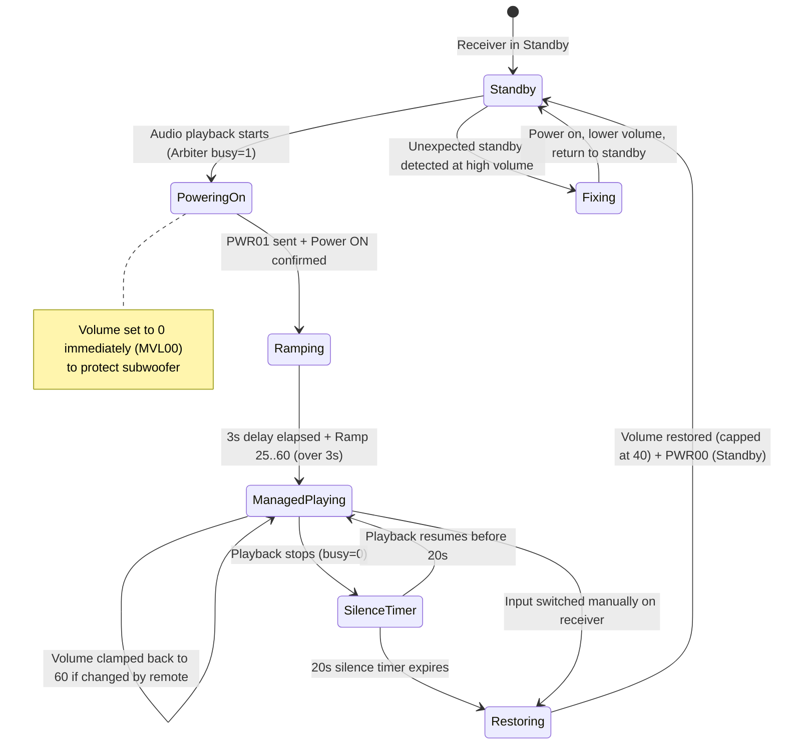

# Specification 04: Onkyo AV Receiver Bridge

## 1. eISCP Protocol (Ethernet Interactive Serial Control Protocol)

The bridge controls Onkyo/Pioneer AV receivers over the eISCP protocol across two network ports:
- **TCP 60128:** Bi-directional control and real-time state telemetry channel.
- **UDP 60128:** Device discovery channel via broadcast.

### 1.1 eISCP Packet Framing
Every command or telemetry message is encapsulated within a 16-byte binary header:

| Bytes | Type | Value / Purpose |
|:---|:---|:---|
| 0 to 3 | 4 ASCII characters | Magic identifier `ISCP` |
| 4 to 7 | 32-bit big-endian int | Header length (always `16`, `\x00\x00\x00\x10`) |
| 8 to 11 | 32-bit big-endian int | Payload data size |
| 12 | 1 byte | Protocol version (`\x01`) |
| 13 to 15 | 3 bytes | Reserved (`\x00\x00\x00`) |
| 16 to N | ASCII string | Payload (e.g. `!1PWR01\r` or `!xECNQSTN\r`) |

---

## 2. Auto-Discovery

When `ONKYO_HOST` is left empty or unset in `soloist.env`, the bridge automatically locates the receiver on the local subnet:

1. Broadcasts a UDP query containing `!xECNQSTN\r` to `<broadcast>:60128` and `255.255.255.255:60128`.
2. The receiver replies with an eISCP packet starting with `!1ECN...` containing model name, port, and MAC address.
3. The bridge extracts the sender IP (`addr[0]`), stores it, and opens the TCP connection.
4. If unreachable or unpowered, it retries with an exponential backoff (1s up to 30s) without blocking other services.

---

## 3. State Machine (`hosts/onkyo-bridge.py`)

---

## 4. Acoustic Safety & Volume Rules

### 4.1 Subwoofer Power-On Protection Ramp
Active subwoofers take ~2.5 seconds to initialize when waking from standby and are sensitive to DC thump or power-on transients:
1. Upon power-on (`PWR01`), volume is immediately muted to zero (`MVL00`).
2. The bridge waits **3 seconds** (`RAMP_DELAY`).
3. Volume is ramped from **25 to 60** (`RAMP_FROM` to `MANAGED_VOLUME`) in equal 200 ms steps over a **3-second duration** (`RAMP_TIME`). Since Onkyo's volume curve is logarithmic (half-dB steps), equal increments yield a smooth natural ramp.

### 4.2 Managed Volume during Playback
While the receiver is on the Pi's input (`ONKYO_INPUT = "03"` / AUX), the bridge owns receiver volume and pins it to `60`:
- Adjustments from the front panel or remote are pushed back to `60` after a brief settling delay (0.3 s).
- Actual listening level is controlled inside client streaming apps (Spotify, iOS volume, etc.).

### 4.3 Silence Timeout & Safe Restoration
1. When playback ceases, a **20-second timer** (`SILENCE_DELAY`) begins.
2. If silence persists for 20 seconds, the bridge:
   - Disconnects active streams (Spotify, AirPlay 2, Bluetooth).
   - Restores the volume recorded before the session started, strictly capped at `40` (`RESTORE_MAX`).
   - Awaits explicit volume confirmation (`MVL...`) before issuing standby (`PWR00`).
   - If the receiver fails to confirm volume reduction, it is kept powered on to prevent leaving it in standby at high volume.

### 4.4 Manual Input Switch
If a user switches the receiver to another input (e.g. TV HDMI or Blu-ray):
- The pre-session volume (capped at 40) is restored immediately.
- The Pi audio session is terminated immediately so streams stop sending audio.

---

## 5. Configuration Variables

| Variable | Default | Purpose |
|:---|:---|:---|
| `ONKYO_HOST` | *(empty)* | Empty = UDP auto-discovery. IP/Host = direct connection. `"false"` = bridge disabled. |
| `ONKYO_PORT` | `60128` | Standard eISCP TCP listening port. |
| `ONKYO_INPUT` | `03` | Hexadecimal Onkyo selector code (`03` = AUX, `01` = VCR/DVR, `23` = CD). |
| `MANAGED_VOLUME`| `60` | Volume applied to the receiver while streaming. |
| `RESTORE_MAX` | `40` | Maximum volume restored upon session exit or standby. |
| `SILENCE_DELAY` | `20` | Silence seconds before disconnecting and powering down. |
| `RAMP_DELAY` | `3` | Seconds after power-on before starting volume ramp. |
| `RAMP_FROM` | `25` | Initial volume step of the ramp. |
| `RAMP_TIME` | `3` | Ramp duration in seconds. |
