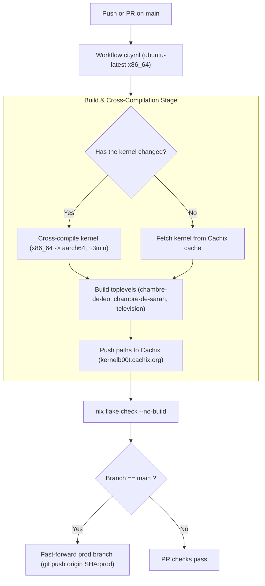

# Specification 06: CI/CD, Binary Caching & Upgrade Lifecycle

## 1. Two-Tier Flake Architecture (`flake.nix`)

The repository isolates flake inputs into two distinct tiers:

1. **Tier 1: Userspace System Inputs (`nixpkgs`, `nixos-hardware`)**
   - Supplies the entire userspace package set (PipeWire, BlueZ, Soloist, systemd, etc.).
   - Updated continuously by **Renovate** via Pull Requests with automatic merge (`automerge: true`).
2. **Tier 2: Linux Kernel Inputs (`nixpkgs-kernel`, `nixos-hardware-kernel`)**
   - Locks the exact Raspberry Pi kernel derivation.
   - Decoupled from userspace `nixpkgs` updates so software bumps do not force kernel rebuilds.
   - Updated exclusively by [`.github/workflows/kernel.yml`](../.github/workflows/kernel.yml) weekly on Sundays at 03:00 UTC.

---

## 2. Continuous Integration Pipeline (CI/CD)



---

## 3. Public Binary Cache (Cachix)

- **Cache Name:** `kernelb00t` (`https://kernelb00t.cachix.org`)
- **Public Key:** `kernelb00t.cachix.org-1:8IJNajMb8SDKZVtPIfDZrbm8XPAEmOmZANZ8E+Ps6V0=`
- **Function:** Stores the cross-compiled kernel, AirPlay 2 packages, and complete system closures.
- **Guarantee:** Edge devices download pre-built binaries and never compile code locally.

---

## 4. Device Deployment & Auto-Upgrade (`autoupgrade.nix`)

Raspberry Pis update autonomously without operator intervention:

### 4.1 Nightly Upgrade Service (`nixos-upgrade.service`)
- **Tracked Branch:** `github:kernelb00t/nix-pi-audio/prod#<hostName>`
- **Execution Schedule:** Daily at **04:30** (`randomizedDelaySec = 20min` to prevent network spikes).
- **In-Place Activation:** `operation = "switch"`.
- **Reboot Policy:** `autoUpgradeReboot = false`. Userspace software updates activate seamlessly without rebooting the player.

### 4.2 Hardware/Kernel Change Detection
After a successful upgrade, a verification script checks:
- `/run/booted-system/kernel` vs `/run/current-system/kernel`
- `/run/booted-system/initrd` vs `/run/current-system/initrd`
- `/run/booted-system/kernel-modules` vs `/run/current-system/kernel-modules`
- `/run/booted-system/firmware` vs `/run/current-system/firmware`

If any of these paths changed, a Discord alert is dispatched (if `DISCORD_WEBHOOK` is configured):  
`"Update applied, but the kernel or firmware changed: reboot the Pi to use it."`

### 4.3 Operator CLI Command (`pi-update`)
Operators connected over SSH can initiate upgrades on demand:
```bash
# Upgrade from the verified production branch:
pi-update

# Or test a development branch (e.g. main):
pi-update main
```
The utility streams progress, switches generation, and alerts the operator if `sudo reboot` is required.
