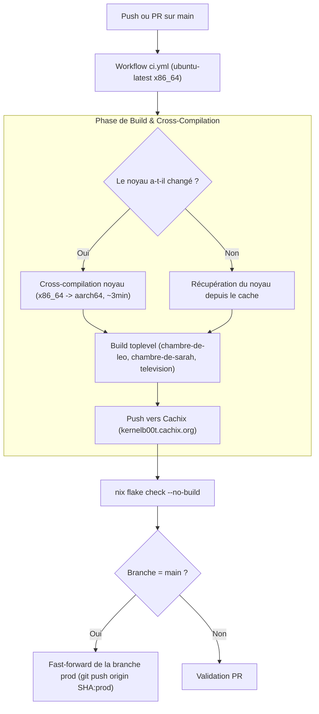

# Spécification 06 : CI/CD, Cache Binaire & Cycle de Mises à Jour

## 1. Architecture Flake à Deux Niveaux (`flake.nix`)

Le dépôt utilise deux ensembles distincts d'épinglages (*pins*) dans [`flake.nix`](../flake.nix) :

1. **Niveau 1 : Inputs du Système Utilisateur (`nixpkgs`, `nixos-hardware`)**
   - Fournit l'ensemble des paquets de l'espace utilisateur (PipeWire, BlueZ, Soloist, etc.).
   - Mis à jour automatiquement par le bot **Renovate** via Pull Requests avec auto-merge (`automerge: true`).
2. **Niveau 2 : Inputs du Noyau Linux (`nixpkgs-kernel`, `nixos-hardware-kernel`)**
   - Fournit la version exacte et les patches du noyau Linux Raspberry Pi.
   - Totalement isolé des mises à jour de routine de `nixpkgs`.
   - Mis à jour uniquement de manière hebdomadaire par le workflow dédié [`.github/workflows/kernel.yml`](../.github/workflows/kernel.yml) le dimanche à 03:00 UTC.

---

## 2. Pipeline d'Intégration Continue (CI/CD)



---

## 3. Cache Binaire Public (Cachix)

- **Nom du cache :** `kernelb00t` (`https://kernelb00t.cachix.org`)
- **Clé publique :** `kernelb00t.cachix.org-1:8IJNajMb8SDKZVtPIfDZrbm8XPAEmOmZANZ8E+Ps6V0=`
- **Rôle :** Stocker le noyau compilé et les paquets non présents sur le cache officiel de NixOS (comme `shairport-sync-airplay2` et les configurations de système complètes).
- **Conséquence :** Les Raspberry Pi ne compilent **jamais aucun code source**. Ils téléchargent exclusivement des paquets binaires pré-validés.

---

## 4. Déploiement et Mise à Jour des Pi (`autoupgrade.nix`)

Les Raspberry Pi sont configurés pour s'actualiser de façon entièrement autonome :

### 4.1 Démon Nocturne (`nixos-upgrade.service`)
- **Branche suivie :** `github:kernelb00t/nix-pi-audio/prod#<hostName>`
- **Heure d'exécution :** Chaque nuit à **04:30** (délai aléatoire `randomizedDelaySec = 20min` pour étaler la charge réseau).
- **Application à chaud :** `operation = "switch"`.
- **Politique de redémarrage :** `autoUpgradeReboot = false`. Les mises à jour logicielles de l'espace utilisateur sont appliquées sans coupure.

### 4.2 Détection de Changement Matériel / Noyau
Après l'application de la mise à jour, un script de vérification compare les chemins réels :
- `/run/booted-system/kernel` vs `/run/current-system/kernel`
- `/run/booted-system/initrd` vs `/run/current-system/initrd`
- `/run/booted-system/kernel-modules` vs `/run/current-system/kernel-modules`
- `/run/booted-system/firmware` vs `/run/current-system/firmware`

Si l'un de ces éléments a été modifié par la nouvelle génération, le Pi envoie une notification sur Discord (si `DISCORD_WEBHOOK` est renseigné) indiquant :  
`"Update applied, but the kernel or firmware changed: reboot the Pi to use it."`

### 4.3 Commande Administrateur Manuelle (`pi-update`)
À tout moment, un administrateur connecté en SSH peut déclencher la mise à jour immédiate :
```bash
# Mise à jour depuis la branche prod :
pi-update

# Test d'une branche de développement (ex: main) :
pi-update main
```
Le script affiche en temps réel les paquets téléchargés, applique la configuration, et indique si un redémarrage (`sudo reboot`) est recommandé.
